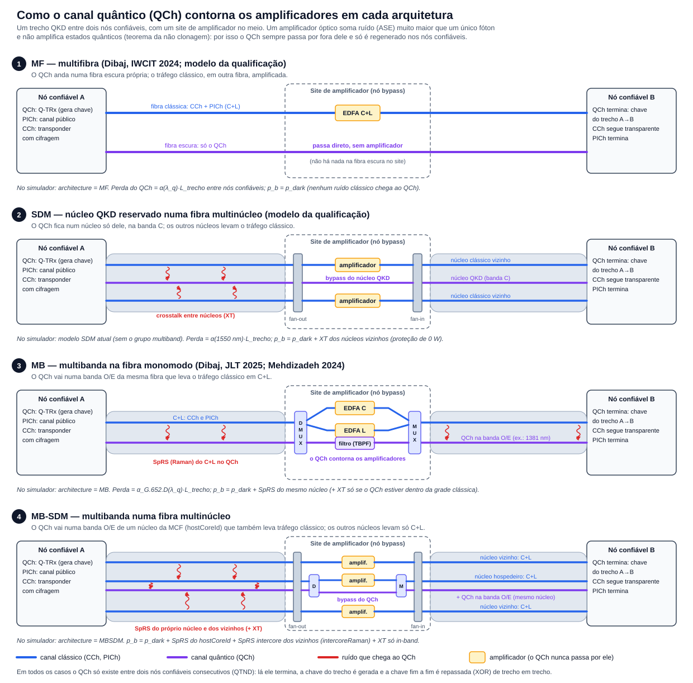

# O canal quântico e os amplificadores: MF, SDM, MB e MB-SDM

Este documento explica como o canal quântico (QCh) passa pelos sites de amplificador em cada arquitetura, o que o
SNetS-SDM-QKD modela disso e como montar um caso multibanda (MB) ou multibanda em fibra multinúcleo (MB-SDM).

## 1. Por que o QCh não passa por amplificadores

- O QCh leva pulsos com menos de um fóton em média (μ = 0,5–0,7). Um amplificador óptico (EDFA, PDFA, BDFA...) soma
  ruído de emissão espontânea (ASE) muitas ordens de grandeza acima disso, e um estado quântico não pode ser copiado
  nem amplificado (teorema da não clonagem).
- Por isso, nos artigos de Dibaj et al., o QCh **nunca** atravessa um amplificador. Há dois tipos de nó no caminho:
  - **nó bypass** (site de amplificador): os canais clássicos (CCh e PICh) são amplificados; o QCh contorna o
    amplificador;
  - **nó confiável** (trusted node): o QCh e o PICh terminam num Q-TRx intermediário, a chave do trecho é gerada e a
    chave fim a fim é repassada de trecho em trecho (XOR, one-time pad). O CCh segue transparente.
- A distância entre nós confiáveis consecutivos é o QTND. A perda do QCh só se acumula dentro de um trecho, e é por
  isso que a SKR depende só do comprimento do trecho.

## 2. Cada arquitetura

### 2.1 MF — multifibra (artigo-base da qualificação: Dibaj et al., IWCIT 2024)

- O QCh anda numa **fibra escura** própria; o CCh e o PICh andam em outra fibra, que é a única amplificada.
- No site de amplificador não há nada na fibra escura: ela simplesmente não tem amplificador. Nas notas de leitura:
  "Em MF a fibra quântica não tem amplificador (QCh contínuo)" (`G1_qkd_multibanda.md`, seção 3.1).
- Ruído no QCh: só a contagem escura do detector (p_b = p_dark). A SKR é a da fibra escura.
- **No simulador:** `multiband.architecture = "MF"`. O núcleo QKD virtual representa a fibra escura.

### 2.2 SDM — núcleo QKD reservado numa fibra multinúcleo (modelo dos estudos da qualificação)

- Foi a forma de levar a ideia da fibra escura para a fibra multinúcleo (MCF): em vez de uma fibra separada, um
  **núcleo** inteiro fica só para o QKD, na banda C, e os outros núcleos levam o tráfego clássico.
- Na prática, num site de amplificador a MCF é aberta núcleo a núcleo (*fan-out*): os núcleos clássicos são
  amplificados (amplificador por núcleo ou multinúcleo) e o núcleo QKD passa por um caminho de bypass, sem
  amplificador; depois os núcleos voltam para a MCF (*fan-in*). Esse arranjo é uma hipótese de projeto do nosso
  modelo: os artigos-base tratam a fibra escura, não a MCF.
- Ruído no QCh: o crosstalk (XT) dos núcleos clássicos vizinhos, porque todos dividem a mesma banda C. A proteção
  das sessões (admissão de XT de 0 W) recusa os circuitos que jogariam XT num QCh ativo.
- **No simulador:** é o modelo usado sem o grupo `multiband`. O núcleo QKD é um núcleo real da MCF, com vizinhos.

### 2.3 MB — multibanda na fibra monomodo (Dibaj et al., JLT 2025; Mehdizadeh et al., 2024)

- O QCh vai numa banda **O ou E** (ex.: 1381 nm) da **mesma fibra** que leva o CCh e o PICh em C ou C+L.
- No site de amplificador, um **demultiplexador de bandas (DMUX)** separa o QCh do C+L. O C e o L são amplificados por
  EDFAs separados; o QCh contorna os amplificadores por um caminho com **filtro passa-faixa (TBPF)**, que barra o ASE e
  os vizinhos; um **MUX** junta tudo de novo. É o "nó QKD bypass" de Dibaj (JLT 2025, Fig. 2).
- Ruído no QCh: o **espalhamento Raman espontâneo (SpRS)** dos canais clássicos do mesmo núcleo, que espalha um pouco de
  luz para outros comprimentos de onda. O XT linear só entra se o QCh estiver dentro da grade clássica.
- **No simulador:** `multiband.architecture = "MB"`. O núcleo QKD virtual representa a banda do QCh dentro do núcleo
  `hostCoreId` da fibra monomodo.

### 2.4 MB-SDM — multibanda numa fibra multinúcleo

- O QCh vai numa banda O ou E de **um núcleo** da MCF (`hostCoreId`), que também leva tráfego clássico em C+L. Os
  outros núcleos levam só C+L, e nenhum núcleo fica reservado: a parte clássica usa todos.
- No site de amplificador juntam-se os dois arranjos anteriores: *fan-out* dos núcleos; no núcleo hospedeiro, DMUX de
  bandas, amplificação só do C+L e bypass do QCh; nos outros núcleos, só amplificação; depois MUX e *fan-in*. Assim
  como no SDM, é uma hipótese de projeto.
- Ruído no QCh: SpRS do próprio núcleo, **SpRS intercore** dos núcleos vizinhos (Cai et al., 2020; opção
  `intercoreRaman`) e XT só se o QCh estiver dentro da grade clássica.
- **No simulador:** `multiband.architecture = "MBSDM"`.

### Resumo

| Arquitetura | Onde está o QCh | O que contorna o amplificador | Ruído no QCh no simulador |
|---|---|---|---|
| MF | fibra escura dedicada | a fibra inteira (sem amplificador) | p_dark |
| SDM (qualificação) | núcleo reservado, banda C | o núcleo QKD (fan-out/fan-in) | p_dark + XT dos vizinhos |
| MB | banda O/E da fibra clássica | a banda do QCh (DMUX/MUX + filtro) | p_dark + SpRS do núcleo (+ XT in-band) |
| MB-SDM | banda O/E de um núcleo da MCF | núcleo + banda (fan-out, DMUX, MUX, fan-in) | p_dark + SpRS do núcleo e dos vizinhos (+ XT in-band) |

## 3. O que o simulador modela do bypass (hipóteses)

- **Perda do QCh:** α(λ_q)·L_trecho, só a fibra. A atenuação vem da curva G.652.D de 1260 a 1675 nm
  (`attenuationModel = "g652d"`) nos casos multibanda e da fórmula α₀ + c·(λ − λ₀)² no modelo SDM.
- **Componentes do bypass sem perda:** DMUX, MUX, filtro, fan-out e fan-in não somam perda ao QCh. É uma hipótese
  otimista. Se for preciso, dá para acrescentar uma perda de inserção por site de amplificador (dB por bypass); hoje
  isso não existe. A perda dos filtros do receptor entra em `detector.receiverOpticalEfficiency` (η_f).
- **Potência clássica no trecho:** os amplificadores repõem a potência dos canais clássicos, então o SpRS de cada
  trecho usa a potência de lançamento (`SIMULACAO_MULTIBANDA.md`, "Hipóteses").
- **Sites de amplificador e nós confiáveis são independentes:** os amplificadores clássicos ficam a cada
  `spanLength` da camada física (80 km nos casos de exemplo) e entram só na QoT clássica; os nós confiáveis ficam a
  cada QTND (25 km nos exemplos). Dibaj põe os nós confiáveis só em sites de amplificador; o simulador não exige isso.

## 4. Como montar e rodar um caso MB ou MB-SDM

O jeito mais simples é copiar um caso de exemplo e mudar o que precisar:

- `simulations/QKD_Multibanda/{Linha,Losango}` (Parte 43): MF, MB e MB-SDM com os três modelos de Raman, e o caso
  SDM de hoje (`MCF7_SDM_nucleoQKD_bandaC`) para comparação. Descrição em `simulations/QKD_Multibanda/LEIA-ME.md`.
- `simulations/QKD_Multibanda_Parte49/{Linha,Losango}` (Partes 48 e 49): grade C+L, QoT clássica por banda com ISRS,
  correção anti-Stokes e escolha do λ do QCh (`maxskr`).

Para montar a partir de um caso seu, no launcher:

1. **Aba Rede.**
   - Em núcleos, escolha "Monomodo + núcleo QKD virtual (multibanda)" (MB e MF numa fibra monomodo) ou
     "7 núcleos + núcleo QKD virtual (multibanda)" (MB-SDM e MF com MCF). O núcleo QKD virtual é o último (1 ou 7),
     declarado com `"adjacentCores": []` e `"qkdReserved": true`, e o `qkd.quantumCoreId` passa a apontar para ele.
   - Nenhum núcleo clássico pode listar o núcleo virtual como vizinho.
   - Ligue o QKD (`qkd.enabled`) e escolha o QTND como de costume.
2. **Aba Camada física QKD, grupo "Multibanda (experimental)":**

   | Campo | O que é |
   |---|---|
   | `architecture` | `MF`, `MB` ou `MBSDM` |
   | `hostCoreId` | núcleo clássico que divide a fibra (MB: 0) ou o núcleo da MCF (MB-SDM, ex.: 1) com o QCh |
   | `qchCenterNm` | λ do QCh: 1260–1460 nm (bandas O e E), ex.: 1381 ou 1310 |
   | `ramanModel` | `nenhum`, `artigo` ou `fisico` (ver `SIMULACAO_MULTIBANDA.md`) |
   | `intercoreRaman` | MB-SDM: soma o SpRS dos núcleos vizinhos ao `hostCoreId` |
   | `bidirectionalFiber` | os dois sentidos do enlace na mesma fibra (SpRS backward) |
   | `classicalBandStartThz` | frequência do slot 1 da grade clássica: 191,3 (banda C, 320 slots) ou 184,4 (C+L, 992 slots) |
   | `antiStokesCorrection` | `nenhuma` ou `medida` (Parte 48) |
   | `nliModel` | `nenhum` ou `gn` (ruído não linear; só pesa com o QCh perto do comb, na banda S) |

3. **Grade C+L (opcional).** Na aba Rede, use 992 slots nos enlaces; na Camada física QKD, `classicalBandStartThz` =
   184,4; e, para a QoT clássica por banda, ative o grupo "QoT clássica por banda (experimental)" na aba Camada física
   (`QOT_CLASSICA_POR_BANDA.md`).
4. **λ do QCh.** `qkd.wavelengthPolicy = "fixed"` põe todos os QChs em `qchCenterNm`; `"grid"` usa uma grade em torno
   dele. `qkd.qchSlotPolicy = "maxskr"` escolhe o λ de maior SKR (Parte 49).
5. **Executar.** Como qualquer caso, com o `SNetS-SDM-QKD.jar` da main. As métricas multibanda (SpRS por QCh etc.)
   aparecem no `QKDMetrics.csv` e no estúdio de gráficos.

Sem o grupo `multiband`, ou com `enabled: false`, o caso roda exatamente como o modelo SDM da qualificação.

Para olhar a física de um único trecho fora do simulador de rede, use a calculadora de enlace (`LEIA-ME.md` desta
pasta), por exemplo: `java -cp SNetS-SDM-QKD.jar qkd.multiband.LinkCalculator arq=mbsdm vizinhos=3 lambda=1381 L=25`.

## 5. Referências

- Dibaj et al., IWCIT 2024 (MF × MB) e JLT 2025 (MB-EON, nós bypass e confiáveis, Fig. 2): `G1_qkd_multibanda.md`.
- Mehdizadeh et al., 2024; Eraerds et al., 2010; Cai et al., 2020 (SpRS e SpRS intercore): `G2_raman_qkd.md`.
- Modelo implementado e hipóteses: `SIMULACAO_MULTIBANDA.md`; QoT clássica por banda: `QOT_CLASSICA_POR_BANDA.md`.
